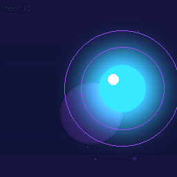

# AnimFlow

可观测、可恢复的动画素材处理管线 **MVP**（笔试题 D 实现）。

浏览器提交一个动画素材任务后 API 立即返回任务 ID；**独立 Worker** 执行有依赖的六步流水线；
每一步的每次尝试、等待原因、租约、错误与产物都持久化在 SQLite 中，可随时查询与恢复。
失败可按步骤自动重试或人工重试，Worker 被硬杀后可换一个 Worker 继续，已完成的有效结果不重跑。

> **诚实边界**：本项目提供 **at-least-once（至少一次）** 执行语义，**不是 exactly-once**；
> 恢复是**步骤边界级**（单步中断整步重跑，没有分帧断点续算）；
> GPU 是**数据库逻辑预约槽位**，不是真实显卡隔离，不采集显存/温度等真实指标；
> 动作规划可选 **真实 DeepSeek** 或离线 MOCK；模型输出实际控制运动与配色。
> 图像由 Pillow 渲染，GPU 仍为模拟槽位，不是 AI 视频生成服务。



[对照产物：橙色光球弹跳](docs/assets/deepseek-bounce-demo.gif)（也是独立真实 DeepSeek 请求）。

## 功能

- 固定六步 DAG：`inspect_asset → (extract_frames ∥ plan_motion) → stylize_frames → render_preview → package_artifact`
- DeepSeek JSON 动作规划，Schema 校验；看板展示模型、请求 ID、耗时与 provider 返回的 token 用量
- 持久任务/步骤/attempt 状态机，事务化领取与发布，步骤级有界重试（默认每轮 3 次）
- 独立 Worker 监督循环 + spawn 子进程：心跳续租、墙钟超时、过期租约回收
- 真实产物：PNG 帧 → 风格变换 → 可播放的多帧 GIF → ZIP（均带 manifest 与 SHA-256）
- attempt 历史、事件时间线（增量分页）、资源槽位看板、等待原因与进度
- 受限故障注入（`demo_fault`）：瞬时失败、持续失败、超时、子进程异常退出、
  「文件写完但事务未提交」的失效窗口等，仅影响指定任务

## 环境

| 项 | 要求 |
| --- | --- |
| Python | 3.12（实测 3.12.4；其他 3.12.x 应可用） |
| 操作系统 | Windows / macOS / Linux（硬杀命令按平台分支） |
| 依赖 | fastapi、uvicorn、pillow、pydantic、python-dotenv（运行）；pytest、httpx（测试） |
| 外部服务 | MOCK 无需外部服务；真实规划需要 DeepSeek Key/额度。不需要本地 GPU、Redis 或 Docker |

## 安装

```bash
git clone https://github.com/tangfire/AnimFlow.git
cd AnimFlow
python -m venv .venv

# Windows
.venv\Scripts\python.exe -m pip install -r requirements-dev.txt
# macOS / Linux
.venv/bin/python -m pip install -r requirements-dev.txt
```

## 启动（两个终端）

```bash
# 终端 1：API（含看板）—— http://127.0.0.1:8000/
.venv\Scripts\python.exe -m uvicorn app.main:app --host 127.0.0.1 --port 8000

# 终端 2：独立 Worker
.venv\Scripts\python.exe -m app.worker
```

两者独立：先开 API 不开 Worker 也能提交任务（排队等待）；先开 Worker 不开 API 不影响执行。
数据默认写入 `data/`（数据库 `data/animflow.db`，产物 `data/artifacts/`，日志 `data/logs/`）。

## 运行测试

pytest 和普通浏览器回归始终走离线 MOCK，不调用付费模型。真实模型验证需要显式运行 `scripts/live_demo.py`。

```bash
.venv\Scripts\python.exe -m pytest tests/ -q
```

原恢复验收套件为 45 项；2026-11-01 新增 30 项模型接入测试（当前共 75 项），最新实际结果见测试报告。
覆盖 A01–A14 全部 P0 验收项，含真实跨进程硬杀恢复与失效窗口测试。
证据与逐项对照见 [docs/test-report.md](docs/test-report.md)。

可选：真实浏览器验证（普通启动与 pytest 不需要；约 2 分钟，11 项断言）：

```powershell
.venv\Scripts\python.exe -m pip install -r requirements-browser.txt
.venv\Scripts\python.exe -m playwright install chromium
.venv\Scripts\python.exe scripts\browser_check.py    # 自启 API/Worker，结束只清理自己的进程
```

## 五分钟演示

[演示视频：3 分 26 秒，7.24 MB，中文字幕、无旁白](docs/assets/AnimFlow-demo.mp4)（GitHub 文件页可下载原始 MP4）。
自动化连续录制方式与边界见 [docs/video.md](docs/video.md)。本机附件副本在 `deliverables/AnimFlow-demo.mp4`，不包含实际 Key。

```bash
# 场景 A：硬杀恢复（约 30 秒，只结束脚本自己创建的进程）
.venv\Scripts\python.exe scripts/crash_demo.py

# 场景 B：成功 / 自动重试 / 人工重试 / GPU 争抢（约 1～2 分钟）
.venv\Scripts\python.exe scripts/demo.py
```

浏览器演示步骤见 [docs/demo-script.md](docs/demo-script.md) 第 4 节。

## 真实 DeepSeek 与录制

在项目根目录把 `.env.example` 复制为 `.env`，只在本机填写 `DEEPSEEK_API_KEY`，API 与 Worker 启动时自动加载。
`.env` 被 Git 忽略；仓库不包含实际密钥。不向浏览器传 Key，也不要在录屏中打开该文件。

看板会在本机配置 Key 后默认选择真实 DeepSeek；仍可手动选 MOCK。用动画要求描述光球运动与配色，
例如“橙色光球上下弹跳，深紫背景，金色光环”。渲染器只支持光球、光环及五种运动原语，不能任意生成角色/场景。
新任务将 `planner_mode`、`planner_model`、`brief` 持久化到输入，运行中的任务不会因 UI 切换模式而改变。
实时规划 JSON 可在页面查询/下载，下游会实际应用 motion、speed、intensity 与三种颜色。

两个 PowerShell 终端分别运行（共享隔离的 `data/recording`；租约 3 秒）：

```powershell
cd D:\AnimFlow
powershell -ExecutionPolicy Bypass -File .\scripts\recording.ps1 api
# 另一个终端：
powershell -ExecutionPolicy Bypass -File .\scripts\recording.ps1 worker
```

浏览器打开 `http://127.0.0.1:8000/`。录制时先展示“真实 DeepSeek”规划卡和 GIF，再演示下游失败重试，
指出 plan_motion 的 attempt 仍为 1。**已经发布的规划可复用；模型响应丢失或发布前崩溃仍可能重复调用/计费。**
真实模式错误不会静默降级：401/403/402 与缺配置直接失败，429/5xx/网络/无效 JSON 由任务预算有界重试。
每 attempt 只发一次请求，无 SDK 隐式重试；网络读取期限 35 秒，步骤 deadline 默认 60 秒由监督进程兜底。

显式付费验证（启动 API 测试客户端与真实 Worker，验证下游失败后规划复用）：

```powershell
.venv\Scripts\python.exe scripts\live_demo.py
# 下列命令只查看已发布真实任务，不再次调用模型（需要可选 Playwright）：
.venv\Scripts\python.exe scripts\browser_live_check.py
```

实测证据：[模型用量与复用](docs/evidence/deepseek-live-2026-11-01.json)、
[看板截图](docs/assets/deepseek-dashboard.png)。首次真实规划输入 561 / 输出 111 / 总计 672 tokens，耗时 2125ms；
这是应用运行用量，与开发智能体使用的 token 是两回事。

管线版本已升为 1.1.0；老 1.0.0 的历史成功任务仍可查询/下载，未完成老版本任务会明确拒绝执行，请新建任务。

## 关键 API

| 方法与路径 | 说明 |
| --- | --- |
| `POST /api/jobs` | 提交任务，`202 {"id","status","status_url"}`；参数非法返回 `422`，不入队 |
| `GET /api/jobs?limit&offset` | 任务摘要分页 |
| `GET /api/jobs/{id}` | 任务、DAG、步骤、等待原因、进度、租约、错误、产物与 `artifact_health` |
| `GET /api/jobs/{id}/attempts` | 真实执行历史（分页） |
| `GET /api/jobs/{id}/events?after_id&limit` | 增量事件；**以返回的 `next_after_id` 继续，不重不漏** |
| `POST /api/jobs/{id}/retry` | 仅 `FAILED` 可人工重试，可带 `{"clear_fault": true}`；其他状态 `409` |
| `GET /api/resources` | CPU/GPU 槽位与 holder（含是否过期）；指标标注「未采集 / MOCK」 |
| `GET /api/planner` | 可用模式与服务端是否配置 Key（不返回 Key，不代表 Worker 已联通） |
| `GET /api/jobs/{id}/motion-plan` | 已发布且摘要有效的动作规划与模型元信息；未生成时 ready=false |
| `GET /api/artifacts/{id}/download` | 按记录下载，下载前全量校验摘要；损坏返回 `409 ARTIFACT_INVALID` |
| `GET /healthz` | API 存活 + 数据库连通（**不等价于有 Worker**） |

统一错误信封：`{"error": {"code", "message"}}`。接口文档见 `http://127.0.0.1:8000/api/docs`。

### 提交示例

```bash
# 嵌套格式
curl -X POST http://127.0.0.1:8000/api/jobs \
  -H "Content-Type: application/json" \
  -d '{"params": {"width":256, "height":256, "frame_count":12, "fps":25, "style":"neon", "seed":42}}'

# 平铺格式（同样支持；非法值/未知键返回 422，不能与 params 混用）
curl -X POST http://127.0.0.1:8000/api/jobs \
  -H "Content-Type: application/json" \
  -d '{"style": "comic", "seed": 7, "demo_fault": {"fail_first_n": {"stylize_frames": 1}}}'
```

## 数据位置与含义

```
data/
  animflow.db          # SQLite（WAL）：jobs/steps/attempts/artifacts/events/resource_slots
  artifacts/<job>/<step>/aN/   # 第 n 次尝试的独享产物目录
  logs/                # API/Worker 日志
```

- **「任务已成功」与「当前文件仍可下载」是两个概念**：成功状态记在数据库；
  之后产物文件被删除或篡改，详情页 `artifact_health` 会变 `invalid`，下载返回 `409`，
  但历史成功记录不会被抹掉（保守策略：请新建任务，不做依赖闭包自动重算）。
- `data/` 不入库（`.gitignore`）；演示用小 GIF 可单独复制到 `docs/assets/`。

## 常见问题

| 现象 | 处理 |
| --- | --- |
| 任务一直 `QUEUED` | 确认 Worker 终端在运行（`/healthz` 只说明 API 与数据库） |
| 页面显示断线 | API 未启动或已停止；页面会自动重试轮询 |
| 步骤长时间 `RETRY_WAIT` | 查看「下次尝试」时间；退避为 `min(2^(n-1), 30)` 秒 |
| 任务 `FAILED` 且 `fatal_error_code=ARTIFACT_INVALID` | 成功产物被破坏，按保守策略新建任务（`clear_fault` 不能修复损坏文件） |
| 测试报端口/进程占用 | 测试与脚本自行分配随机端口并清理自己创建的进程；若上次异常中断，重启终端即可 |
| 想重来 | 关闭两个终端，删除 `data/` 目录后重启（历史会清空） |

## 文档

- [SUBMISSION.md](SUBMISSION.md) — 提交简要说明
- [docs/architecture.md](docs/architecture.md) — 数据模型、事务、崩溃窗口、小时级演进与 GPU 边界
- [docs/test-report.md](docs/test-report.md) — 测试矩阵与实测证据
- [docs/demo-script.md](docs/demo-script.md) — 可复现实验步骤
- [docs/decisions.md](docs/decisions.md) — 设计决策与未实现项
- [docs/ai-usage.md](docs/ai-usage.md)、[docs/worklog.md](docs/worklog.md) — AI 使用与工时（本人填写）
- [plan.md](plan.md) / [acceptance.md](acceptance.md) — 原始规格与验收矩阵

## 发布（GitHub）

本地已完成；**尚未在未登录浏览器验证公开可读**。本人执行：

```bash
# 确认 origin 指向自己的仓库且已登录（gh auth status 或 git credential）
git status                 # 应干净
git push origin main       # 推送已验证的提交
```

然后用**未登录浏览器**打开 `https://github.com/tangfire/AnimFlow` 确认公开可读。
公网部署为可选项，本地 `127.0.0.1` **不能**当作公网 URL。
