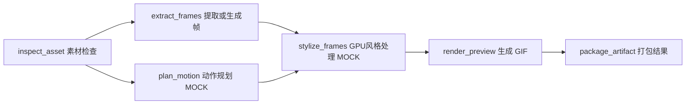

# 题 D：可恢复动画素材任务管线 MVP

## 1. 目标与交付定位

实现一个单机、低并发、持久化的 AI 任务管线。浏览器提交一个动画素材处理任务后，API 立即返回任务 ID；独立 Worker 执行有依赖的步骤；浏览器可查询每一步、每次尝试、等待原因和产物。失败可按步骤重试，Worker 中断后可恢复，已完成的有效结果可复用。

建议项目名 `AnimFlow`。这不是生产工作流引擎。评审重点是持久化状态、失败语义、恢复边界和实验记录。计算允许 MOCK，但数据库、跨进程执行、进程终止、重启恢复、GIF 产物和状态查询必须真实实现。

题目允许“公网 URL 或公开 GitHub 仓库”，优先交付公开仓库。公网演示是可选项，不能替代源码、测试和启动说明。禁止在说明里承诺“完美完成”或保证录用。

## 2. 固定技术选择与边界

| 部分 | 选择 | 理由与边界 |
| --- | --- | --- |
| 语言 | Python 3.12，明确记录实际测试版本 | 易于连接真实 AI 计算，Windows/Linux 都可运行 |
| HTTP | FastAPI + Uvicorn + Pydantic | 提交、状态、历史与下载接口；不在请求里做计算 |
| 持久化 | 标准库 sqlite3，WAL，外键，busy_timeout，短事务 | 同机共享本地磁盘，足够解释事务与抢占正确性；仍只有一个写者 |
| 执行 | 独立 `python -m app.worker` 监督进程 + 步骤子进程 | API 与长计算分离，子进程故障不阻塞监督循环 |
| 产物 | 本地持久目录 + SHA-256 + manifest | 不把二进制塞数据库；重试时可校验完整性 |
| 演示素材 | Pillow 生成合成帧、确定性风格变换、真实 GIF 与 ZIP | 无模型密钥、无 GPU 也可复现 |
| UI | 同源 HTML/CSS/原生 JavaScript，每秒轮询 | 不引入前端构建链；刷新后从 API 恢复展示 |
| 验证 | pytest + HTTP/API 集成测试 + 真实子进程故障测试 | 重点验证恢复语义，不追求凑覆盖率 |

不用 FastAPI BackgroundTasks 当可靠队列；不用内存列表当任务事实来源；不用 API 启动钩子偷偷启动 Worker；不持有数据库事务等待计算。

P0 不做：通用 DAG 编辑器、登录权限、任意文件上传、任意外部 URL 抓取、跨机器 Worker、真实 GPU 调度、跨任务全局缓存、WebSocket/SSE、暂停/取消、真实视频模型推理。上述能力写入扩展讨论，不生成空壳功能。

## 3. 示例管线与步骤契约

输入为内置 `demo_asset_v1` 的合成素材配方：width、height、frame_count、fps、style、seed。设置小范围上限，比如尺寸至多 512、帧数至多 48；参数校验失败不入队。默认生成 12 帧、256×256 动画。页面明确写“演示素材由程序生成，AI 与 GPU 计算为模拟”。

| 步骤 | 依赖 | 资源 | 真实输出 |
| --- | --- | --- | --- |
| inspect_asset | 无 | CPU | 标准化素材参数 JSON |
| extract_frames | inspect_asset | CPU | 按参数生成的一组 PNG 与帧清单 |
| plan_motion | inspect_asset | CPU | 确定性动作/风格规划 JSON，模拟 AI 规划 |
| stylize_frames | extract_frames, plan_motion | mock GPU | 经 Pillow 确定性处理的 PNG 与清单 |
| render_preview | stylize_frames | CPU | 可打开、帧数正确的动画 GIF |
| package_artifact | render_preview | CPU | GIF、配置和来源摘要组成的 ZIP 与 manifest |

每个步骤定义 name、version、depends_on、resource、max_attempts_per_round、timeout_seconds。定义集中在一个模块。启动时检查唯一名称、依赖存在、无环；数据库存一份该任务的 DAG/版本快照。运行中的任务不随代码里 DAG 变化而静默变更；Worker 遇到不支持的版本要明确报告，不能误跑。

步骤只读取不可变输入与成功上游的产物清单，写入本次 attempt 独享目录，产出结构化结果或错误。不要让 MOCK 直接改业务状态，不要让计算函数直接提交成功状态。最终 ZIP 不必把所有诊断日志都塞进去。

## 4. 执行模型与必须守住的不变量

运行组件：API、Worker 监督循环、步骤执行子进程、同一本地 SQLite 数据库、同一本地 artifacts 目录。默认 CPU 槽位 2、模拟 GPU 槽位 1；可以启动两个 Worker 验证竞争。

所有业务状态写入走集中的 repository/service 层。每个进程使用自己的数据库连接。对 claim、heartbeat、complete、fail、recover、manual_retry 使用短事务；涉及竞争的路径用 `BEGIN IMMEDIATE`，再带条件更新并检查影响行数。锁忙进行有界重试，不能整段计算持锁。初始化并发启动应安全。

必须保持：

1. 创建任务及全部步骤在一个事务内完成；接口返回成功即表示已持久化。
2. 只有依赖全部 SUCCEEDED、产物有效、重试时间已到、资源可用的步骤才可领取。
3. 同一逻辑步骤同时只有一个**有效租约**；领取步骤和占用资源必须同事务成功。
4. attempt_id 是唯一执行身份。所有心跳、进度、结束、释放资源必须匹配 active_attempt_id、owner，并满足租约仍有效。
5. 旧 attempt 在租约失效或新 attempt 建立后不能提交成功、覆盖进度、释放新 attempt 的资源。拒绝陈旧结果要能在日志里找到原因。
6. 步骤成功、attempt 终态、artifact 记录、资源释放、业务事件、任务聚合在同一数据库事务内提交。
7. SUCCEEDED 依赖持久产物有效；下载与复用前检查文件存在及摘要。缺失、损坏不能静默当成功。
8. 重试有上限，历史追加不覆盖；API 重启、浏览器刷新不影响执行。

这里提供 at-least-once 的执行语义：崩溃后计算可能重做；通过身份检查、产物隔离和事务提交保证只有当前有效 attempt 能发布结果。不要把它称作计算 exactly-once。

## 5. 领取、续租与恢复的具体顺序

监督循环每次执行有界工作，绝不阻塞等待一个步骤结束：

1. 处理已结束子进程的结果；校验身份、租约和产物后提交。
2. 对本 Worker 有效执行中的 attempt 续租；从子进程进度文件读取进展，校验身份后限频持久化。
3. 检查步骤墙钟期限；超时结束子进程并回收，再记录 TIMED_OUT 和按策略重试。监督进程的存活不等于计算取得进展。
4. 事务内回收过期租约，结束旧 attempt，释放它拥有的资源，记录 WORKER_LOST，安排重试或终止。
5. 按创建时间公平扫描可领取步骤，资源忙时跳过继续找其他工作。事务内校验依赖与资源、建立 attempt、占槽、更新任务与事件。
6. 事务提交后启动子进程；启动失败走失败路径。claim 后启动前崩溃也由过期租约恢复。

默认示例：poll=0.5s、heartbeat=2s、lease=10s、步骤 timeout=60s，可配置且校验 lease 明显大于 heartbeat。演示耗时每步 1～3 秒，慢任务可设 20 秒；不要真的跑一小时才证明设计。

子进程建议显式使用 multiprocessing 的 spawn，上下文可序列化，入口保护 `if __name__ == '__main__'`。不跨进程传 sqlite 连接。可采用 attempt 独立的原子 progress/result JSON 文件传递结果，避免监督进程阻塞在无界 IPC 或损坏队列。只采信结构化、有限大小的结果；子进程退出码异常、缺结果文件都视为执行失败。

心跳表达监督进程仍对该 attempt 负责；progress_updated_at 表达业务进展。耗时使用单调时钟；持久时间使用 UTC epoch，UI 显示本地时间。单机时钟跳变是已知限制，不夸大租约为物理隔离。

Worker 被硬杀时，子进程可能短暂残留。旧进程只能写旧 attempt 目录，不能发布数据库状态。可实现父进程存活检查使 MOCK 子进程尽快退出，但不要把它当作真实 GPU 强隔离保证。

## 6. 状态、失败与人工重试

### 任务

`QUEUED → RUNNING → SUCCEEDED | FAILED`

- QUEUED：已入库，尚无步骤被领取。
- RUNNING：已开始，包含执行中、等待资源、等待自动重试、故障后排空在途步骤的阶段。
- SUCCEEDED：全部步骤成功且最终产物已校验。
- FAILED：出现不可恢复/耗尽重试的失败，所有在途步骤已结束，未完成步骤标为 BLOCKED。
- FAILED 可以通过人工 retry 回到 QUEUED，成功步骤保留；有独立 event 记录这次状态回退。

### 步骤与 attempt

步骤：`PENDING → RUNNING → SUCCEEDED`；可重试失败为 `RUNNING → RETRY_WAIT → RUNNING`；不可重试或次数耗尽为 `RUNNING → FAILED`；任务最终失败时未开始的剩余步骤为 BLOCKED。

PENDING 的等待原因单独查询得出：DEPENDENCIES / CPU_RESOURCE / GPU_RESOURCE；RETRY_WAIT 展示 RETRY_BACKOFF 和下次尝试时间。不要每次轮询都追加一条等待事件。不要为了显示“等待 GPU”就先领取 attempt，资源没拿到不消耗尝试次数。

attempt 状态：RUNNING、SUCCEEDED、FAILED、TIMED_OUT、WORKER_LOST。每次真实领取都追加 attempt；attempt_no 单调递增。每步骤另有 retry_round 与 attempts_in_round，默认每轮最多 3 次总尝试，第一次也算。崩溃也消耗一次，避免坏任务无限循环。

可重试错误包括模拟瞬时失败、异常退出、超时、Worker 丢失。参数不合法在 HTTP 校验阶段拒绝；步骤发现不可恢复数据错误直接失败。错误保留 code、简短 message、retryable；详细栈写结构化日志，界面不过量展示。

自动重试退避例如 min(2^(attempts_in_round-1), 30) 秒。测试可注入时钟/缩短配置，生产示例可加抖动，不要靠长 sleep 等待重试。

采用 fail-fast：出现最终失败后不再领取该任务的新步骤，也不再启动它尚未执行的自动重试；已运行的独立分支允许结束并保留成功产物。等在途执行排空后任务变 FAILED，其余未完成步骤 BLOCKED，reason=JOB_FAILED。不要一边 task=FAILED 一边步骤继续正常更新 RUNNING。

人工 retry 只接受 FAILED 任务，单事务将所有 FAILED/BLOCKED 步骤恢复 PENDING、各自 retry_round 加一、attempts_in_round 归零，保留旧 attempts/events 和成功步骤。任务回 QUEUED。对运行中或成功任务调用返回 409；重复请求不会开启两轮。演示可用 clear_fault=true 清除故障注入，不能改真实业务参数。

## 7. 最小持久化模型

可以增加字段，不随意删掉影响恢复的字段。时间字段统一单位。

| 表 | 必要信息 | 作用 |
| --- | --- | --- |
| jobs | id、status、input_json、input_hash、pipeline_version、dag_snapshot、fatal_error_code/message 可空、created_at、updated_at、started_at、finished_at | 恢复输入、版本、任务聚合状态；持久化任务级完整性错误 |
| steps | id、job_id、name、version、depends_on_json、status、resource、active_attempt_id、attempt_count、retry_round、attempts_in_round、max_attempts_per_round、next_run_at、timeout_seconds、progress、progress_updated_at、output_fingerprint、error_code/message | 恢复调度与展示；UNIQUE(job_id,name) |
| attempts | id、step_id、attempt_no、retry_round、owner、status、lease_expires_at、heartbeat_at、started_at、deadline_at、finished_at、error_code/message、work_dir | 审计每一次执行与租约；UNIQUE(step_id,attempt_no) |
| artifacts | id、step_id、attempt_id、relative_path、sha256、size_bytes、kind、manifest_json、created_at | 仅记录已发布产物，校验与下载 |
| events | 自增 id、job_id、step_id/attempt_id 可空、type、payload_json、created_at | 结构化业务历史，和对应状态同事务落库 |
| resource_slots | id、kind、device_label、holder_attempt_id 可空 | CPU/GPU 槽位，holder 唯一且引用 attempt |

资源租约权威时间来自 holder attempt，避免复制两个互相矛盾的过期时间。slots 初始化幂等；占用/释放都条件更新 holder_attempt_id。过期回收和其他状态变更同事务；不能把“把 slots 全部清空”当恢复。

事件至少包括 JOB_CREATED、STEP_CLAIMED、STEP_RETRY_SCHEDULED、STEP_SUCCEEDED、STEP_FAILED、ATTEMPT_TIMED_OUT、ATTEMPT_WORKER_LOST、JOB_SUCCEEDED、JOB_FAILED、JOB_RETRIED、OUTPUT_REUSED、ARTIFACT_INVALID。心跳不逐条写事件。events 是审计历史，不要求通过 event sourcing 重建全库。

输出指纹 = SHA256(规范化 JSON(步骤名与版本、pipeline_version、本步骤相关业务参数、按依赖名排序的上游输出摘要、seed、演示模型版本))。排除耗时、worker_id、故障注入、重试次数等执行参数。JSON 序列化排序且无不稳定值；真实非确定推理需讨论随机种子和模型/提示词版本。

## 8. 产物提交与结果复用

每次 attempt 写 `artifacts/<job>/<step>/<attempt>/`，文件先写临时名，再同目录原子重命名，最后写 manifest。计算完成后监督进程校验清单、文件尺寸和摘要，再进行受租约保护的数据库发布。文件与 SQLite 不是同一个事务，这个间隙必须解释：

- 写了一半就崩溃：没有已发布记录，不能复用，重试写新目录。
- 文件齐全但数据库未提交：孤儿产物，P0 允许重算；不会视作成功。
- 数据库已提交后 Worker 崩溃：成功保留，重启不重跑。
- 旧 attempt 晚到：忽略其结果，不能覆盖新目录或记录。

P0 复用范围是**同一个任务恢复/人工重试时保留有效成功步骤**，不建跨任务缓存。在恢复/人工 retry 的预检中校验成功产物；复用路径保留原 artifact/attempt，写 OUTPUT_REUSED，不追加假的计算 attempt。

若成功产物缺失或摘要不符，P0 保守策略是拒绝继续该任务并返回明确 ARTIFACT_INVALID，保留历史；用户重建新任务。运行中的依赖检查发现损坏则停止领取该任务，排空后 FAILED。无需实现复杂的依赖闭包回滚。下载发现损坏返回明确 409 错误并记录事件；已完成任务的历史成功不抹掉，响应另带 artifact_health=invalid。README 要说明“已成功”和“当前文件仍可下载”是两个概念。

任务恢复的预检在领取新步骤之前执行，避免先复用损坏结果再补检查。没有活动 Worker 时只查询状态，不声称已自动完成预检。

ARTIFACT_INVALID、不可支持的 pipeline_version 等没有自然归属失败步骤的错误，写入 jobs.fatal_error_code/message 并追加事件；阻止新领取、排空在途后 FAILED。任务聚合同时检查最终失败步骤与该任务级错误，避免停在 RUNNING。人工 retry 前仍须通过完整性/版本预检，否则返回 409 并保留失败；clear_fault 只能清除演示注入，不会修复损坏文件。预检和 OUTPUT_REUSED 按实际恢复/人工重试轮次记录，不能每次轮询重复写事件。

P1 可做分块 checkpoint：stylize_frames 以少量帧为块，持久化输入指纹、已完成块摘要与 manifest；续跑只复用已校验块。P0 只支持**步骤边界恢复**，单个步骤中断会整步重跑，必须如实标注。

## 9. GPU：可演示的部分与物理边界

P0 的 resource_slots 持久化 CPU 槽位与一个 `mock-gpu-0`，必须实际限制同时有效领取的 GPU attempt 数。CPU 与 GPU 分池，排 GPU 的任务不应阻塞另一个任务可运行的 CPU 步骤。

界面展示：资源需求、占用 attempt/worker、资源等待时长、模拟设备名；真实 utilization、显存、温度字段显示“未采集 / MOCK”，不能生成貌似实测的监控数据。

两个任务竞争 GPU，只有一个获得有效槽位；正常完成或超时释放；Worker 死亡后租约回收释放。用测试验证**数据库中有效预约数**，不宣称证明了显卡实际进程数。

租约过期不保证旧 CUDA 进程消失。真实 GPU 调度需要节点侧执行代理、可靠进程/容器终止及退出确认，确认释放后再分配；设备失联应隔离并标记 UNKNOWN，不立即重新分配。生产中另需 GPU 型号/显存约束、OOM 分类与降级、模型加载时间、DCGM/NVML 指标、资源配额和等待公平性。P0 仅有模拟槽位，不依赖真实显卡。

## 10. 查询 API 与看板

接口前缀 `/api`，同源静态页面在 `/`：

| 方法与路径 | 最小契约 |
| --- | --- |
| POST /api/jobs | 输入业务参数与 demo_fault；202 返回 id/status/status_url；可选 Idempotency-Key 为 P1 |
| GET /api/jobs?limit=20&offset=0 | 有界分页，任务摘要 |
| GET /api/jobs/{id} | 任务、DAG、步骤、等待原因、进度、attempt_count、租约、错误、产物摘要、artifact_health |
| GET /api/jobs/{id}/attempts | 真实执行历史，有界分页 |
| GET /api/jobs/{id}/events?after_id=0&limit=100 | 按 id 升序的增量事件，带 next_after_id；无遗漏消费规则写入文档 |
| POST /api/jobs/{id}/retry | FAILED → QUEUED，可带 clear_fault；返回更新任务，非法状态 409 |
| GET /api/resources | CPU/GPU 槽位当前 holder、是否过期、设备类型 |
| GET /api/artifacts/{id}/download | 通过记录查找路径并限制在产物根目录；不接受任意磁盘路径 |
| GET /healthz | API 存活与数据库连通；不等价于有 Worker |

接口中 404/409/422 有统一易读错误。所有输入有长度/数量上限。HTTP 提交在 Worker 未启动时也能成功，随后启动 Worker 可消费。

看板只要求好读、完整：创建任务与预设场景、任务列表、固定 DAG 或依赖列表、步骤状态卡、时间线、attempt 历史、资源槽位、重试按钮、真实 GIF 预览与 ZIP 下载。刷新恢复选择可用 URL 参数 job_id。轮询处理断网/404/终态停止或降频，不重复插入旧事件。

进度用步骤真实报告的工作单元；无法估计时用不确定进度条。整体显示“已完成 x/6 步”，不把它伪装成精确剩余时间。显示 waiting / retry / failed，不能把所有未完成都叫“运行中”。

## 11. 小时级演进与 AI 步骤划分

文档必须回答：租约按秒续期、执行期限按步骤成本独立设置，不能把 lease 改成一小时当长任务支持；心跳与执行进展分开；长步骤按帧/片段 checkpoint，控制重复 GPU 成本；避免长事务和常驻 HTTP 连接；持久存储产物而非容器临时盘；事件分页、日志保留、磁盘容量与孤儿清理；数据库在线备份要考虑 WAL，不只复制活跃 db 文件。

单机瓶颈明确后才演进 PostgreSQL 的并发领取、对象存储、独立节点代理或成熟工作流引擎；不把 SQLite WAL 放在跨主机网络文件系统上。外部推理服务需要业务幂等键、保存 external_job_id、提交后失联时先查状态再决定是否重投，防止重复计费；本项目不假装解决外部副作用。

划分独立步骤的依据：产物稳定、计算成本高、失败域不同、资源不同、可单独校验、具备复用价值。例：抽帧/转码 CPU；镜头规划 LLM；逐帧/分片风格化 GPU；合成 CPU。不要把每一次小函数调用都变成任务，也不要把整个小时 GPU 推理塞成一个不可恢复黑盒。

## 12. 参考依据

以下资料用于解释选型，不替代本项目实测：

- [SQLite 适用场景](https://www.sqlite.org/whentouse.html)：适合单机本地持久化，写并发与多机部署有边界。
- [SQLite 事务](https://www.sqlite.org/lang_transaction.html)：一个同时写事务，BEGIN IMMEDIATE 的竞争行为。
- [SQLite WAL](https://www.sqlite.org/wal.html)：读写并发及同主机限制。
- [FastAPI Background Tasks](https://fastapi.tiangolo.com/tutorial/background-tasks/)：轻量响应后任务与重计算的边界。
- [Python multiprocessing](https://docs.python.org/3.12/library/multiprocessing.html)：spawn、进程入口和进程生命周期。

最终依赖应选择实施时可安装且兼容的明确版本并锁定，记录实际 Python/SQLite 运行时版本。不从这份计划推断某个未知安装包已验证。
